# EventHub

Community event planner. Members create and manage local workshops, meetups, sports days,
cultural and charity events, see the **current weather** and a **map pin** for each event's
city, and upload an **event poster**.

**Live:** https://eventhub-three-khaki.vercel.app
**Plan and decisions:** [`docs/req/`](docs/req/) (requirements, pages, design, data model, auth, integrations, progress)

## Features

- Sign up (full name, email, password), log in, log out; private pages redirect to login and back
- Dashboard "My events": cards with poster, title, date, city and category; search by title; filter by Workshop, Meetup, Sports, Cultural, Charity; empty and no-results states; pagination
- Create and edit events: title, description, category, date (not in the past when creating), city, venue, poster; errors under each field
- Poster upload: JPG, PNG or WebP up to 5 MB, compressed to WebP in the browser, stored in a private Supabase Storage bucket, shown through signed URLs
- Event details: all information, poster, current weather (temperature, condition, humidity, wind), a tip for attendees, and a map pin
- Delete with a confirmation that names the event
- Friendly errors with **Try again** when the weather service fails or the city isn't found; skeletons while loading

## Tech stack

Next.js 16 (App Router), TypeScript, Tailwind CSS v4, shadcn/ui on Base UI, React Hook Form + Zod,
Supabase (Auth, Postgres, Storage), axios, Leaflet + OpenStreetMap, Vercel.

## Architecture

```
Browser ──► Next.js on Vercel
            ├─ proxy.ts           refreshes the Supabase cookie session; logged-out users → /login?next=…
            ├─ Server pages       requireUser() → data layer (src/lib/data/events.ts) → Supabase Postgres (RLS)
            ├─ Server actions     createEvent / updateEvent / deleteEvent: Zod → requireUser() → write → cleanup
            ├─ /api/upload        auth, size, type and file-signature checks → Storage images/{user_id}/{uuid}
            └─ /api/weather       auth + Zod query → src/lib/api/weather.ts (axios via src/lib/http.ts)
                                    OpenWeatherMap → fallback Open-Meteo, 8 s timeout, 1 retry, 10 min cache
```

- **Authentication:** Supabase Auth (approved alternative to Firebase). Sessions in HTTP-only cookies via `@supabase/ssr`. Three layers: proxy redirect, `requireUser()` in every protected page/action/route, and Row Level Security.
- **Data:** `events` table (`supabase/migrations/`), four owner-only RLS policies (`auth.uid() = user_id`), `check` constraints that match the Zod schema in `src/lib/validations/event.ts`.
- **Storage:** private `images` bucket (5 MB, JPG/PNG/WebP only) with owner-folder policies; old posters are deleted on replace and on event delete.
- **External API:** called only on the server, response validated with Zod and mapped to our own `WeatherSummary`; status-coded errors (400, 401, 404, 502, 503, 504) shown as friendly messages.

## Environment variables

Copy `.env.example` to `.env.local`:

| Name | Where to find it | Public? |
|---|---|---|
| `NEXT_PUBLIC_SUPABASE_URL` | Supabase → Project Settings → API | Yes |
| `NEXT_PUBLIC_SUPABASE_ANON_KEY` | Supabase → Project Settings → API (anon key; safe because of RLS) | Yes |
| `OPENWEATHER_API_KEY` | https://home.openweathermap.org/api_keys (free) | **No, server only** |

### API keys needed
- **OpenWeatherMap** (optional): free key for current weather. Without it the app uses **Open-Meteo**, which needs no key.
- **OpenStreetMap tiles** and **Open-Meteo**: no key.
- The Supabase `service_role` key is **not** used anywhere.

## Local setup

1. `npm install`
2. Copy `.env.example` to `.env.local` and fill in the values.
3. Apply the SQL files in `supabase/migrations/` to your Supabase project, in order.
4. Supabase → Authentication: turn **Confirm email** off; add `http://localhost:3000/**` (and your Vercel URL) to Redirect URLs.
5. `npm run dev` and open http://localhost:3000.

## Scripts

| Command | What it does |
|---|---|
| `npm run dev` | Development server |
| `npm run check` | Lint, typecheck, unit tests and production build |
| `npm test` | Unit tests (event schema, weather tips, error mapping, storage paths) |
| `npm run test:e2e` | Playwright smoke test |

## Screenshots

Taken by a headless end-to-end run (37 checks) against the app, in pipeline order.

| # | Step | Screenshot |
|---|---|---|
| 1 | Landing page with Sign up and Log in | 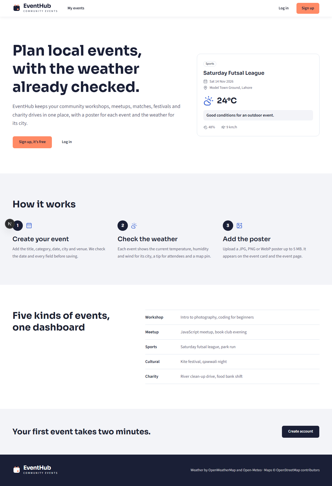 |
| 2 | Login with a friendly error for a wrong password | 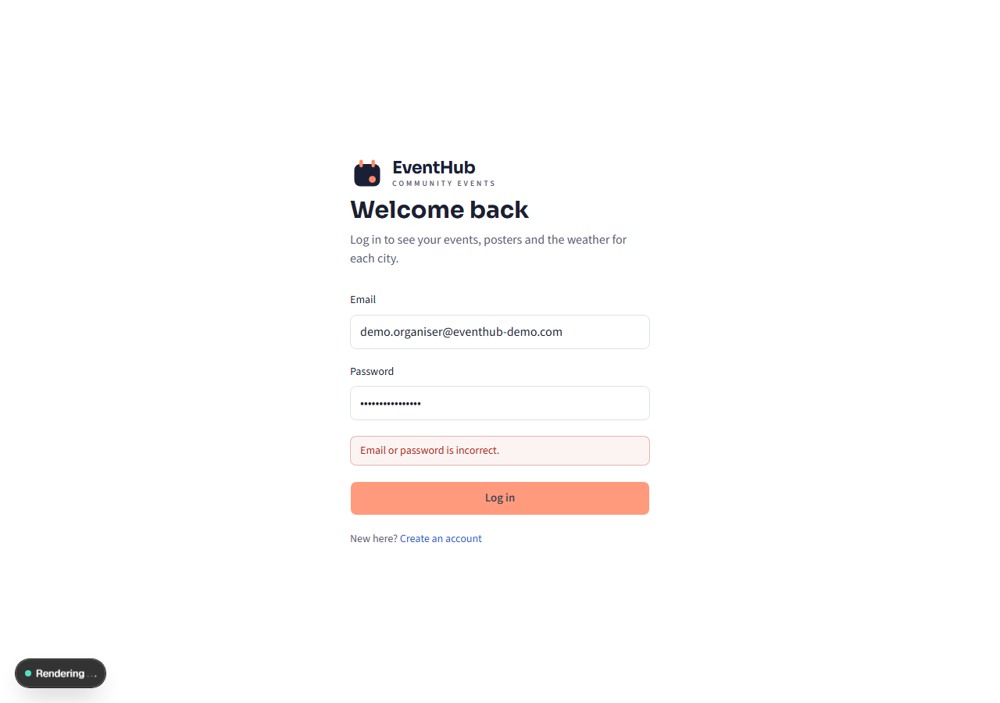 |
| 3 | Dashboard empty state for a new account | 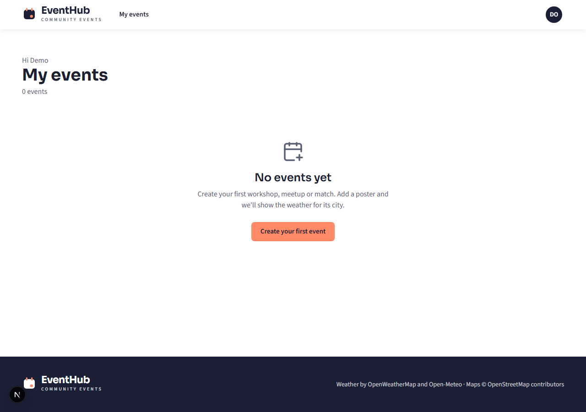 |
| 4 | Create event: errors under each field, past date rejected | 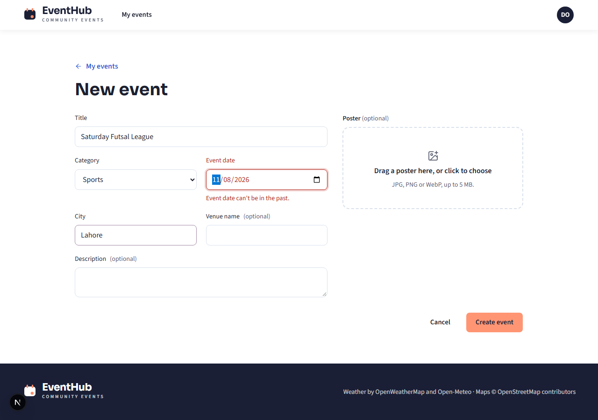 |
| 5 | Create event filled in, with poster preview | 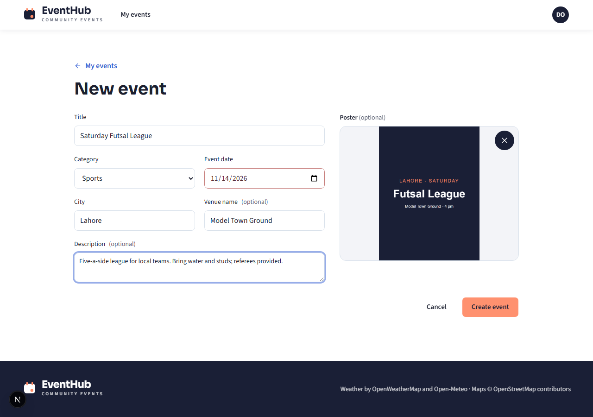 |
| 6 | Event details: poster, current weather, attendee tip, map pin | 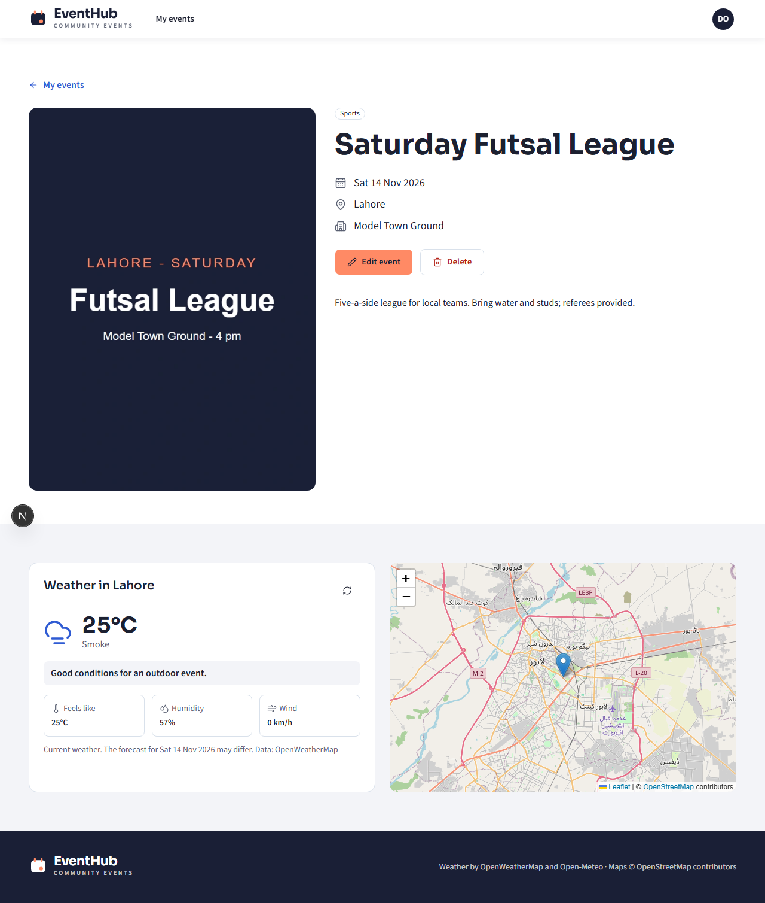 |
| 7 | City not found: friendly message, Try again, map fallback | 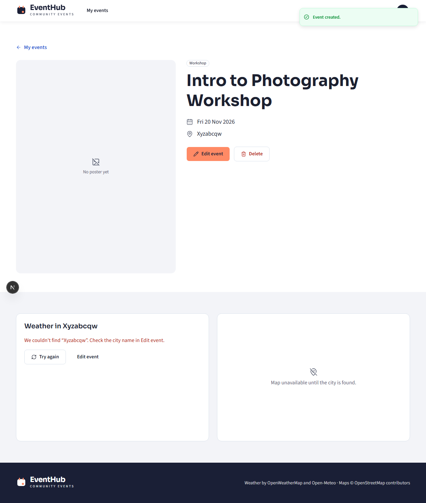 |
| 8 | Dashboard with event cards | 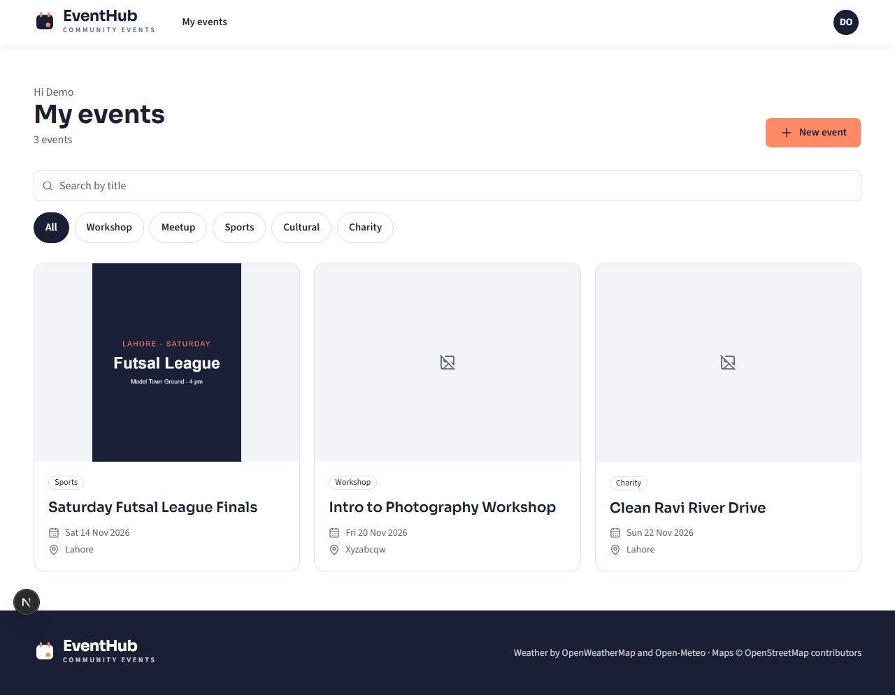 |
| 9 | Category filter (Charity) | 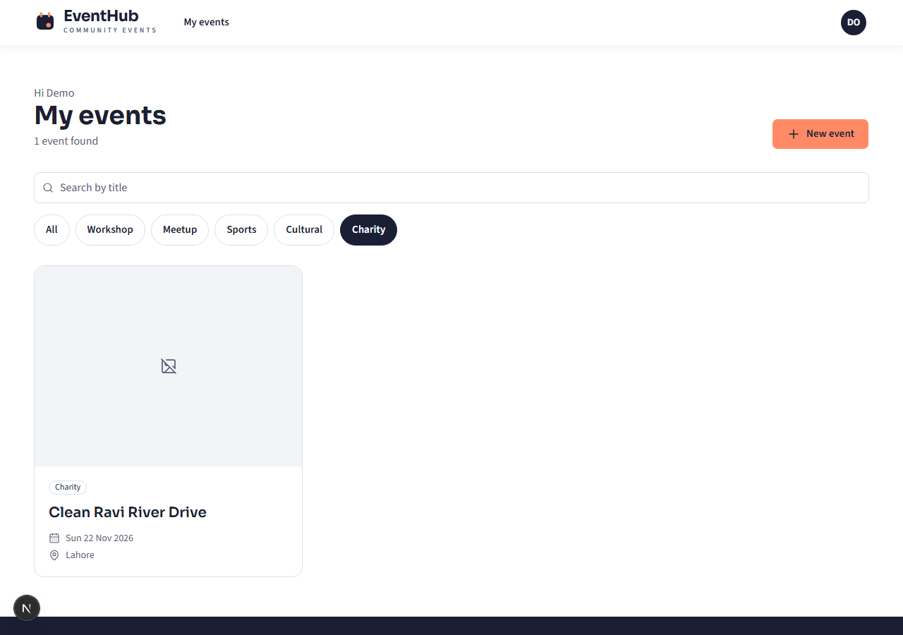 |
| 10 | Delete confirmation naming the event | 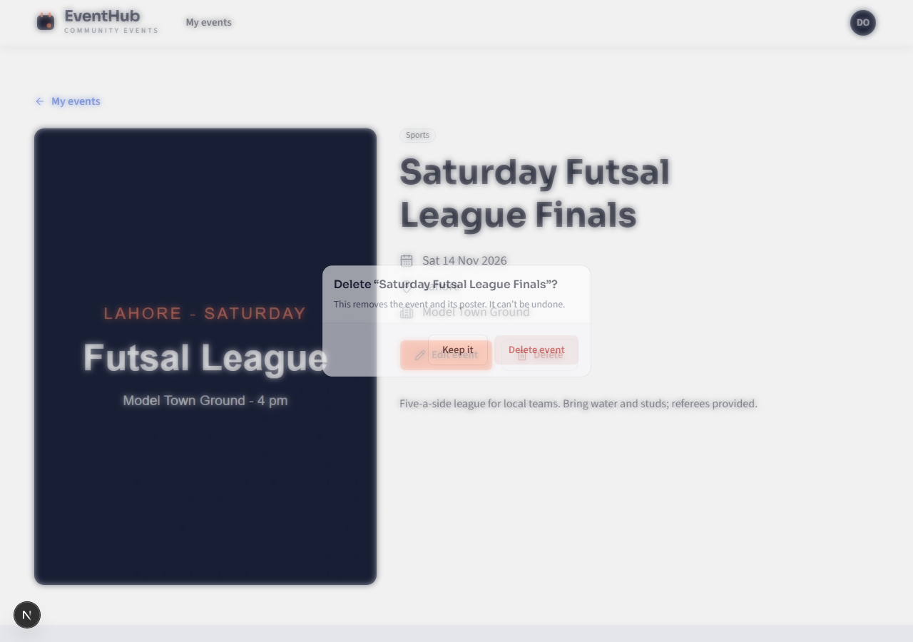 |
| 11 | Event page on a phone (375 px) | 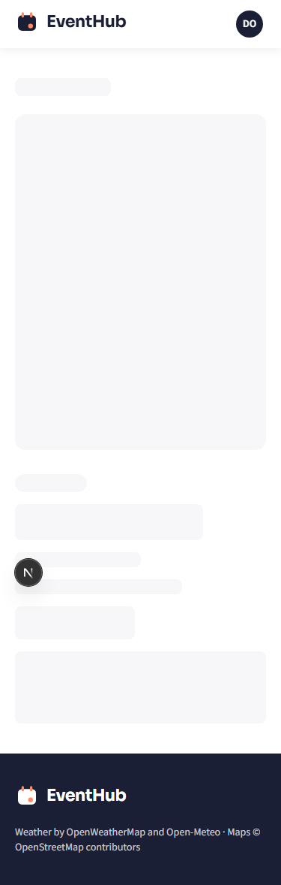 |
